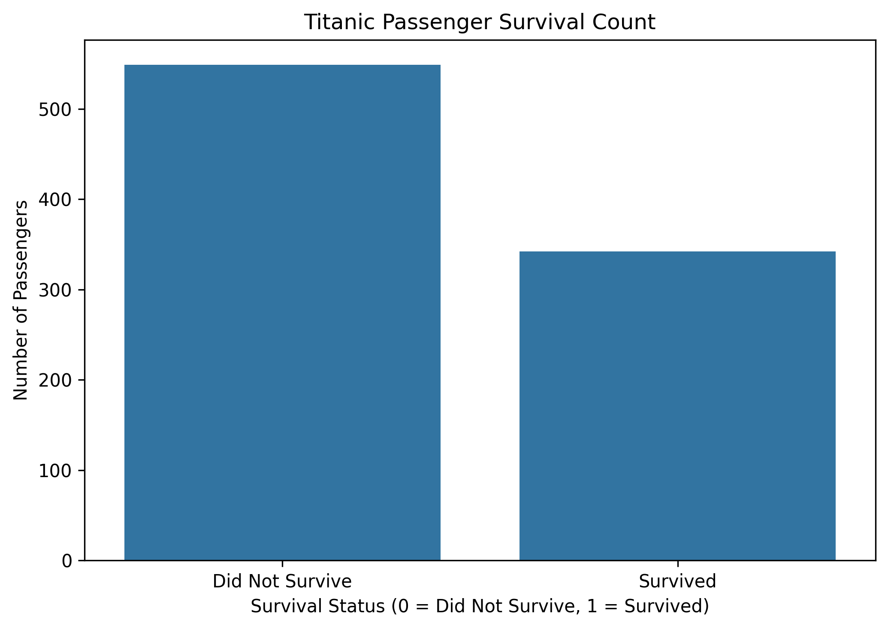
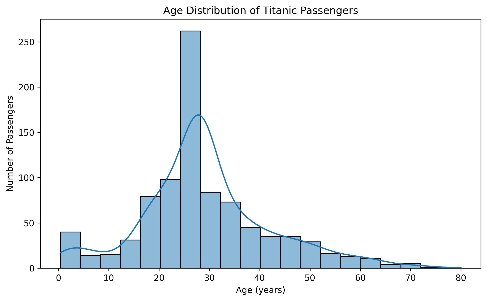
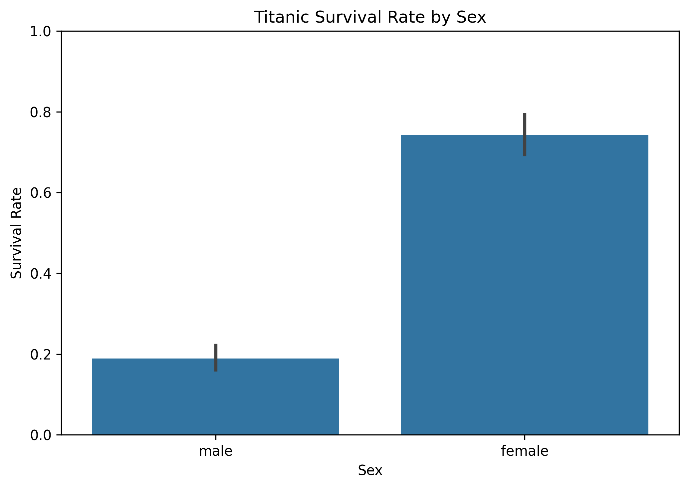
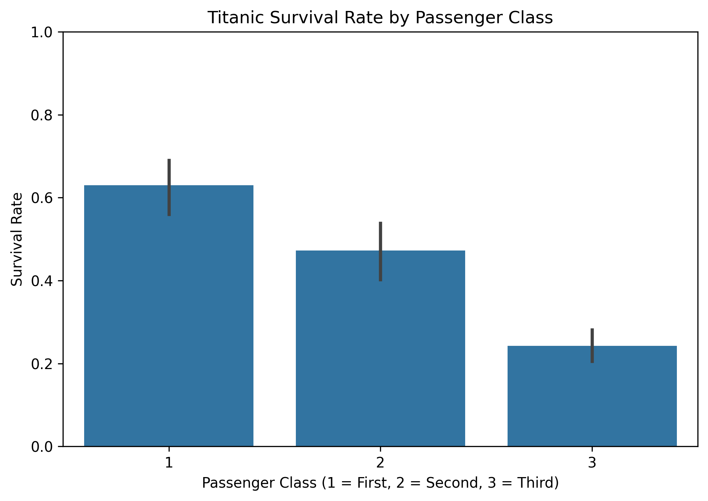
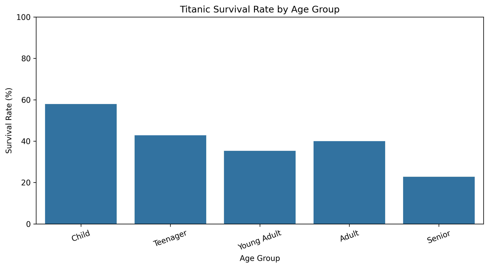

# Titanic Survival Analysis

## Project Overview
This project explores the Titanic passenger dataset using Python to understand survival patterns and identify factors associated with passenger survival.

## Objectives
- Perform data cleaning and preprocessing.
- Conduct Exploratory Data Analysis (EDA).
- Analyze survival rates based on gender, passenger class, and age groups.
- Visualize findings using graphs.

## Technologies Used
- Python
- Pandas
- NumPy
- Matplotlib
- Seaborn
- Jupyter Notebook

## Dataset
The project uses the Titanic dataset containing 891 passenger records and 12 original columns.

## Data Cleaning
- Filled missing Age values using the median.
- Filled missing Embarked values using the mode.
- Dropped the Cabin column due to a large number of missing values.
- Prepared the cleaned dataset for analysis.

## Key Findings
- Overall survival rate: 38.38%.
- Female survival rate: 74.20%.
- Male survival rate: 18.89%.
- First-class survival rate: 62.96%.
- Second-class survival rate: 47.28%.
- Third-class survival rate: 24.24%.
- Children had the highest observed survival rate among the analyzed age groups.

## Visualizations

### 1. Survival Count

### 2. Age Distribution

### 3. Survival by Gender

### 4. Survival by Passenger Class

### 5. Survival by Age Group

## Project Files
- `Titanic_Survival_Analysis.ipynb` – Complete analysis and Python code.
- `Titanic-Dataset.csv` – Dataset used.
- `Titanic_Survival_Analysis_Report.pdf` – Project report.
- PNG files – Data visualizations.

## Conclusion
The analysis shows differences in observed survival rates across gender, passenger class, and age groups. This project demonstrates practical skills in data cleaning, exploratory data analysis, data visualization, and interpreting data-driven insights.

## Author
Sudipta Das
